# LEGITCHECK

**Look Legit. Look Closer.**

LEGITCHECK is a minimal, privacy-first web application for inspecting suspicious messages, lookalike URLs, UPI/payment prompts, and screenshots—tailored for digital fraud patterns across **India and APAC**.

It operates on a **Dual Analysis Engine** architecture inspired by independent local vs. cloud processing:
- **Local Mode (Offline NLP Engine):** 100% deterministic browser-side text normalization, tokenisation, contextual negation handling, weighted multi-signal scoring, and entity extraction. Zero network requests; submitted text never leaves your device.
- **AI Mode (Server-Side Gemini):** Contextual language and screenshot analysis powered securely through Express (`POST /api/analyze`) using `API_KEY`, returning schema-validated explanations, entity extraction, and protective actions.

> **Advisory Disclaimer:** Both Local Mode and AI Mode surface behavioral risk indicators, extracted identifiers, and practical safety steps. Neither engine guarantees safety or performs live bank KYC, RDAP/WHOIS, or telecom caller verification without dedicated external feeds.

---

## Screenshots

### Dual-Engine Check & Sample Presets
| Minimal Home & Mode Switcher | Quick Demo Samples Dropdown |
| --- | --- |
| 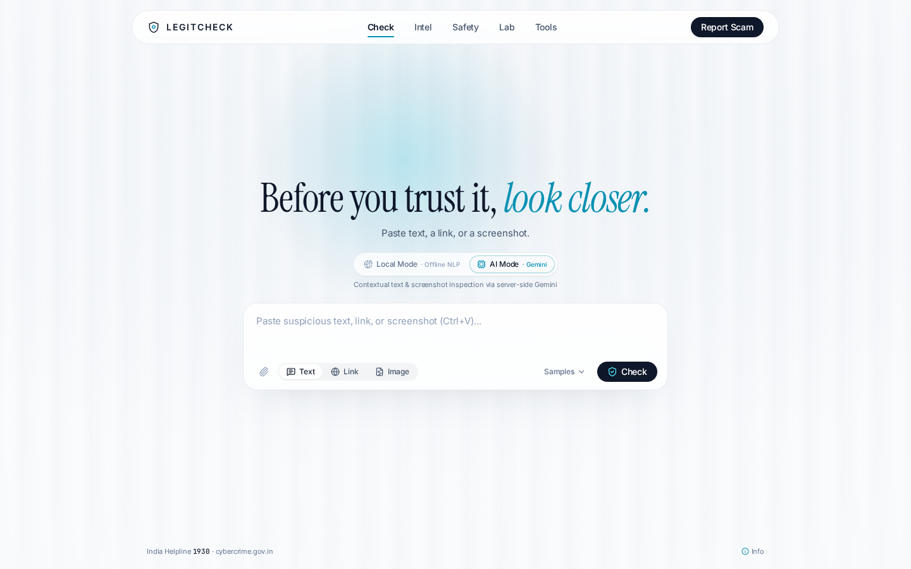 | 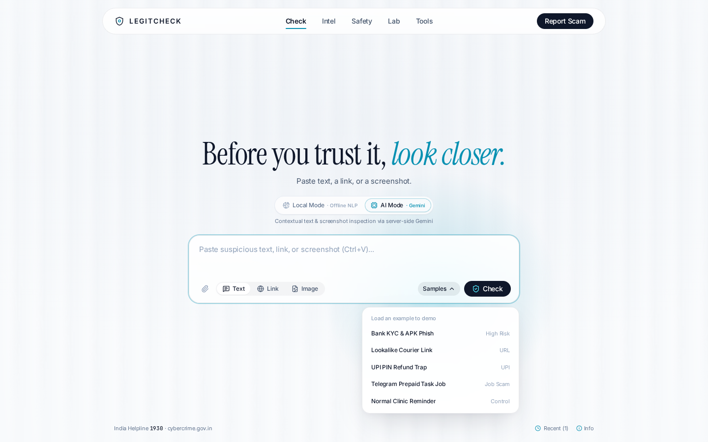 |

### Local Mode, AI Mode & Smart Fallback
| Local Mode Offline Verdict | Local Mode Heuristic Breakdown | AI Mode Contextual Verdict | Smart Fallback on AI Error |
| --- | --- | --- | --- |
| 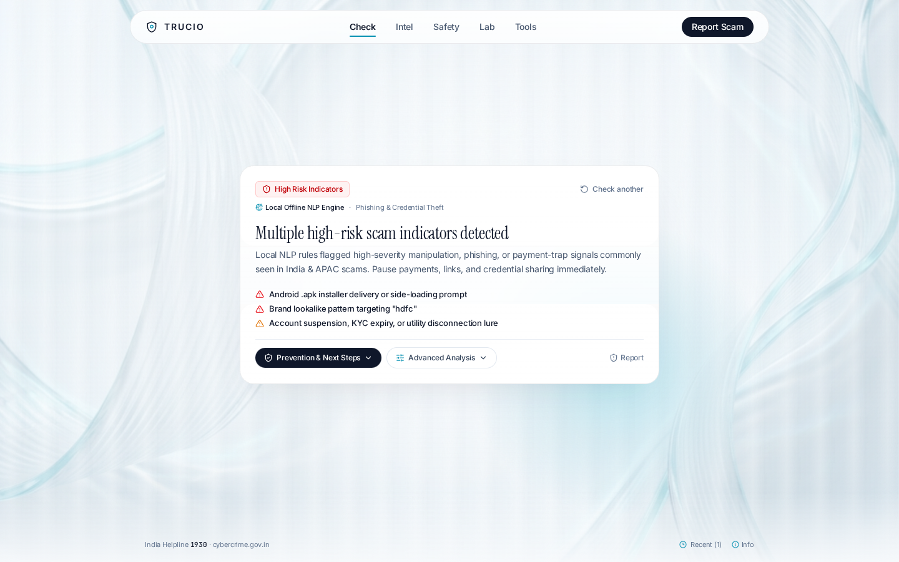 | 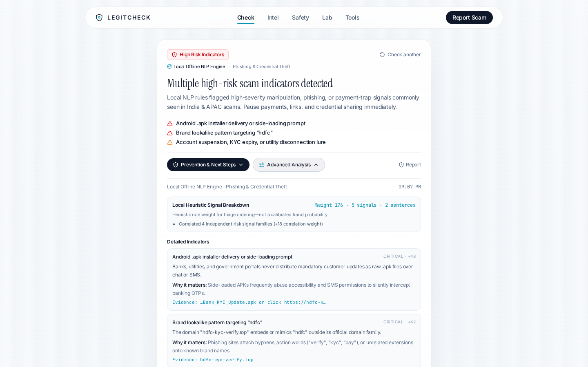 | 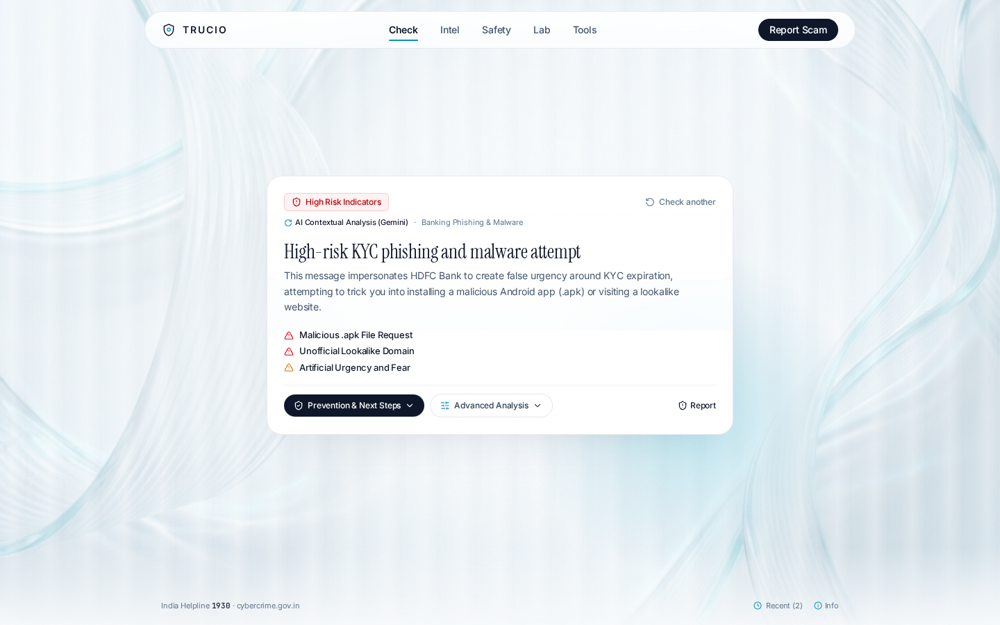 | 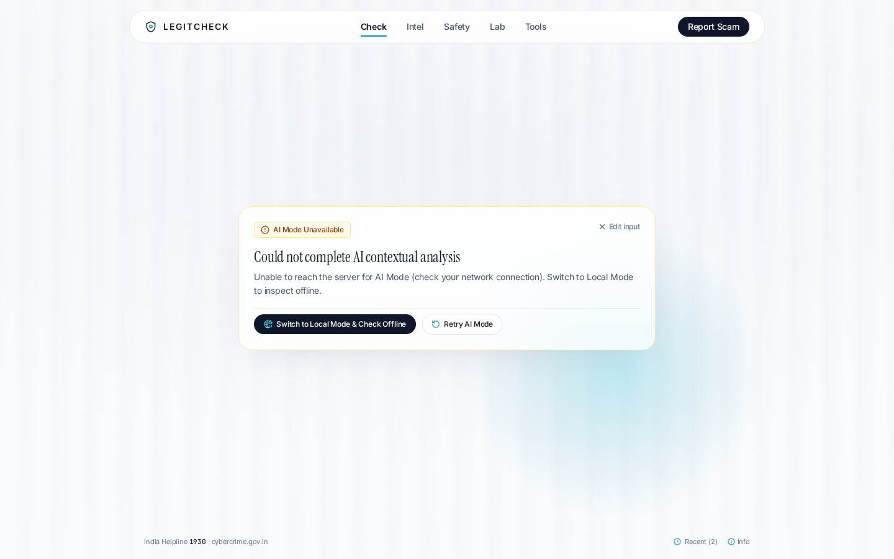 |

### Workspaces & Mobile Layout
| India & APAC Scam Intel | Safety & Recovery Centre | Interactive Scam Lab |
| --- | --- | --- |
| 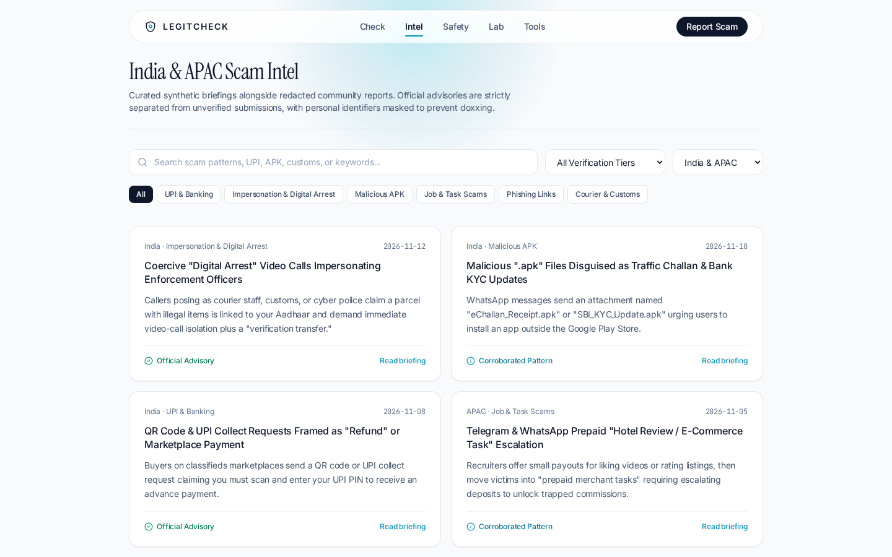 | 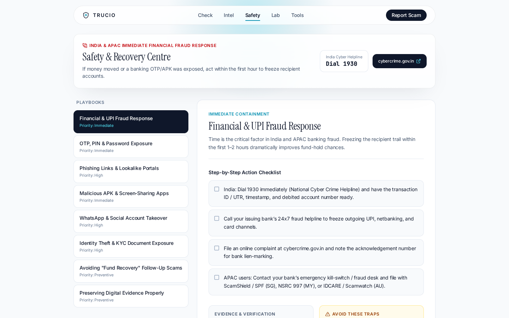 | 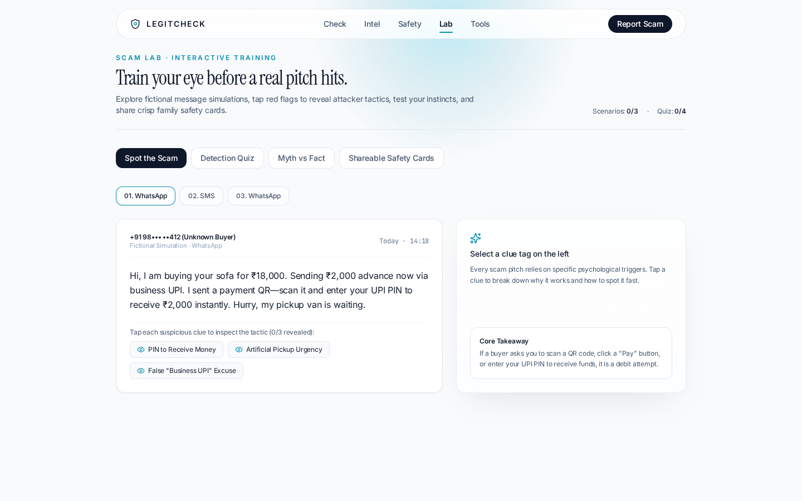 |

| Technical Tools Workspace | Mobile Home (`390×844`) |
| --- | --- |
| 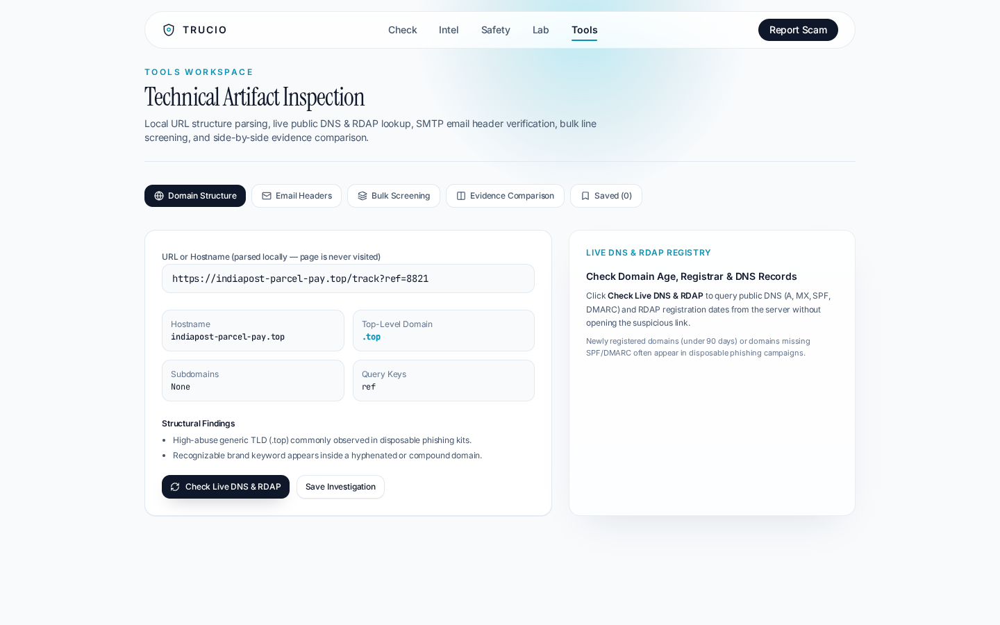 | 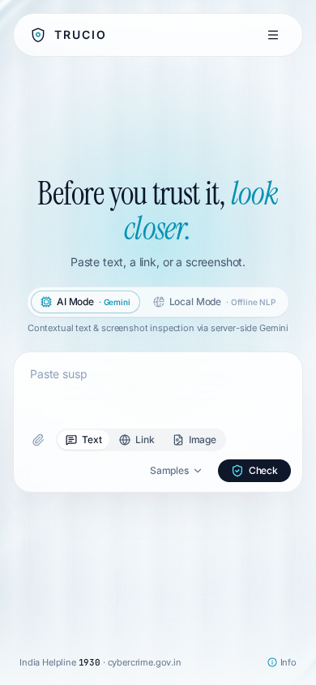 |

---

## Dual Analysis Engine: Local Mode vs. AI Mode

| Capability | Local Mode (`Offline NLP`) | AI Mode (`Gemini`) |
| --- | --- | --- |
| **Execution Environment** | 100% client-side in browser (`src/engine/local/`) | Server-side Express proxy (`server.ts` -> `/api/analyze`) |
| **Internet / API Key Required** | **No** — runs offline with zero network calls | **Yes** — requires `API_KEY` on server |
| **Privacy Guarantee** | Submitted text never leaves your device | Sent only to server proxy & Gemini API (not published) |
| **Detection Approach** | Unicode/leetspeak normalization, sentence segmentation, context-aware negation & advisory damping, 15 modular weighted signal rules, entity extraction | Full contextual reasoning across multi-turn chats, nuanced manipulation, and visual UI clues |
| **Screenshot / Image Inspection** | Image-only submissions report insufficient textual signal and advise switching to AI Mode | Multimodal inspection of uploaded or pasted screenshots (`PNG`/`JPG`/`WEBP`) |
| **Output Transparency** | Explicitly labeled `Local Offline NLP Engine` with non-probabilistic heuristic rule weight breakdown | Explicitly labeled `AI Contextual Analysis (Gemini)` with schema-validated findings |
| **Smart Fallback** | Always available independently | On missing key, `429` quota limit, network failure, or invalid JSON, UI prompts to **Retry AI Mode** or **Switch to Local Mode & Check Offline** |

---

## Core Features

- **Minimal Single-Screen Check (`/`):** Paste text, a URL, or an image (`Ctrl+V`), attach screenshots (up to 5 MB), toggle **Local Mode** vs **AI Mode**, or load five instant demo cases from **Samples**.
- **Progressive Disclosure Verdicts:** Highlights the caution badge, active engine attribution, suspected scam category, issue summary, and top risk indicators upfront—keeping **Prevention & Next Steps** and **Advanced Analysis** (heuristic weight breakdown, *why each indicator matters*, exact evidence snippets, extracted entities, and detection limitations) collapsed until opened.
- **India & APAC Scam Intel:** Searchable catalog distinguishing curated advisory briefings from custom local entries across `Digital Arrest`, `.apk` banking malware, UPI collect/QR traps, prepaid task job scams, and courier/customs phishing.
- **Safety & Recovery Centre:** Actionable containment playbooks emphasizing **India 1930** (`cybercrime.gov.in`) alongside APAC helplines (`SG 1799`, `MY 997`, `HK 18222`, Scamwatch AU).
- **Interactive Scam Lab:** Spot-the-scam exercises, quick quizzes, Myth vs Fact cards, and shareable family safety reminders.
- **Technical Tools Workspace (Lazy-Loaded):** Local URL/domain structure inspection, SMTP header parser, bulk line screener, side-by-side comparison, and saved investigations.
- **Local Incident Reporting:** 6-step structured incident builder saved to browser `localStorage` with JSON export and explicit notices that entries are not transmitted to law enforcement.

---

## Technology Stack

- **Frontend:** React 19, TypeScript 7, Vite 8, Tailwind CSS v4, Motion (`motion/react`), Lucide React, `hls.js`
- **Offline NLP Engine:** Zero-dependency TypeScript pipeline (`src/engine/local/`)
- **Backend Proxy:** Express (`server.ts`) serving Vite middleware in development and `dist/` + `/api/*` in production
- **AI SDK:** `@google/genai` (server-side only in `server.ts`)

---

## Project Structure

```text
├── server.ts                        # Express server, /api/health, schema-validated POST /api/analyze
├── index.html                       # App HTML entry point & OpenGraph metadata
├── metadata.json                    # App capabilities metadata
├── .env.example                     # Environment variable template (safe to commit)
├── src/
│   ├── App.tsx                      # Root router, engine mode persistence, ambient motion backdrop
│   ├── engine/local/
│   │   ├── nlp.ts                   # NFKC normalization, de-obfuscation, tokenisation, negation & advisory context
│   │   ├── entities.ts              # URL, domain, lookalike, Punycode, UPI, phone, email, and amount extractors
│   │   ├── rules.ts                 # 15 modular weighted scam signal rules + category & severity metadata
│   │   └── engine.ts                # Sentence-level correlation, contextual damping, non-probabilistic breakdown
│   ├── services/
│   │   └── analysisService.ts       # Dual-engine router, health check, strict AI JSON validation
│   ├── components/ui/               # Navbar, EngineModeToggle, Modal, StatusBadge, BackgroundVideo, ToastContainer
│   ├── features/home/               # CentralCheckingBox, QuickVerdictCard, AiFailureCard
│   ├── pages/                       # HomePage, AnalysisPage, ScamIntelPage, SafetyCentrePage, ScamLabPage, AdvancedWorkspacePage, ReportScamPage
│   ├── data/                        # Static intel, safety playbooks, and scam lab exercises
│   ├── types/legitcheck.ts          # Shared TypeScript interfaces for Local Mode, AI Mode, and UI state
│   └── utils/                       # analyzer.ts (facade + header/domain tools), storage.ts
└── tests/
    └── localEngine.eval.ts          # Offline evaluation harness (24 fictional cases across 8 buckets)
```

---

## Installation & Local Development

### Prerequisites
- **Node.js** `20+` (recommended LTS)
- **npm** (or Bun, matching `bun.lock`)

### 1. Install dependencies
```bash
npm install
```

### 2. Configure environment variables
Copy `.env.example` to `.env.local` (`.env*` secrets are gitignored; `.env.example` is tracked):

```bash
cp .env.example .env.local
```

Edit `.env.local`:
```env
# Required only for AI Mode (Local Mode works completely offline without this key)
API_KEY="your-gemini-api-key"

# Optional Gemini API model override
GEMINI_MODEL="gemini-2.5-flash"

PORT=3000
APP_URL="http://localhost:3000"
```

### 3. Run the development server
```bash
npm run dev
```
Open [http://localhost:3000](http://localhost:3000).

### 4. Run checks & offline evaluation
```bash
# TypeScript static type-checking
npm run lint

# Offline Local Mode evaluation suite (24 fictional cases across 8 buckets)
npm run eval
```

### 5. Production build & server
```bash
npm run build
npm start
```

---

## Deploying to Vercel

LEGITCHECK runs an Express backend (`server.ts`) alongside the Vite client bundle (`dist/`) so `API_KEY` stays strictly on the server:

1. Push the repository to GitHub (confirm `.env.local` is ignored and never committed).
2. Import the repository in **Vercel**:
   - **Build Command:** `npm run build`
   - **Output Directory:** `dist`
   - **Entrypoint / Express Server:** Vercel supports Express servers (`server.ts`) natively when configured as the Node/Express entrypoint, or you can deploy `/api/analyze` & `/api/health` as Vercel Functions paired with the `dist/` build.
3. In **Vercel Project Settings → Environment Variables**, add:
   - `API_KEY` = your Google Gemini API key
   - `GEMINI_MODEL` = `gemini-2.5-flash` (recommended for production)
4. **Deploying without an API key:** If `API_KEY` is omitted, `GET /api/health` reports `geminiConfigured: false`. LEGITCHECK automatically defaults first-time visitors to **Local Mode**, and selecting **AI Mode** cleanly prompts users to switch back to offline Local Mode instead of failing silently.

---

## Security & Detection Limitations

- **Zero Client Secret Exposure:** `API_KEY` and `@google/genai` exist strictly in `server.ts`. Vite never bundles server secrets into `src/`.
- **Heuristic Limitations:** Local Mode relies on deterministic pattern rules and NLP heuristics; novel phrasing, image-only screenshots, and obfuscated social engineering may not match offline rules. Never treat a `Low-Signal Indicators` output as proof that a message is safe.
- **No Uncalibrated Accuracy Claims:** `npm run eval` tests our 24 synthetic fictional scenarios (covering obvious scams, sophisticated traps, legitimate bank OTP alerts, genuine recruiter outreach, legitimate P2P transfers, normal chats, ambiguous messages, and Hinglish/leetspeak obfuscation) to catch false positives and regressions—it is not a population-wide statistical benchmark.
- **Browser-Local Storage:** Mode preferences, recent check history, custom Intel cards, Safety checklist progress, and incident drafts reside in `localStorage` on your device.
- **Emergency Help (India & APAC):** If funds were debited, a UPI PIN was entered on a collect request, or an `.apk` was installed in India, immediately call **1930** and submit an official report at [cybercrime.gov.in](https://cybercrime.gov.in).

---

*Built with care — Made by Ash.*
